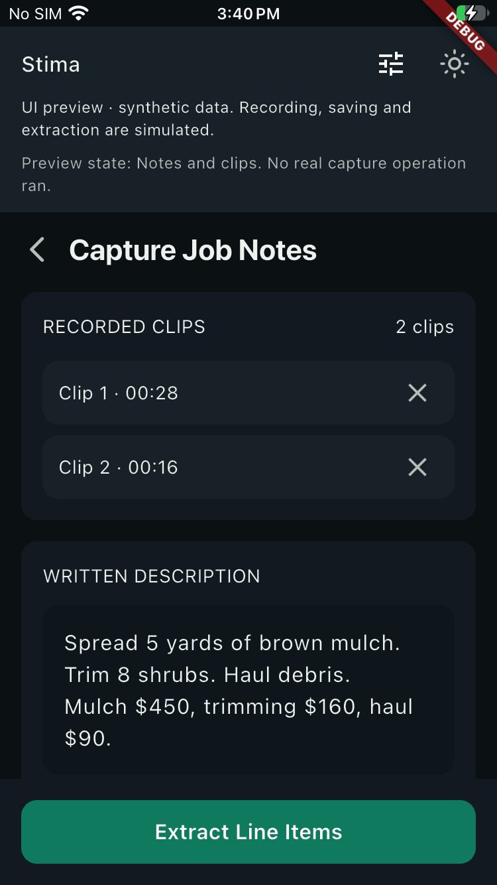
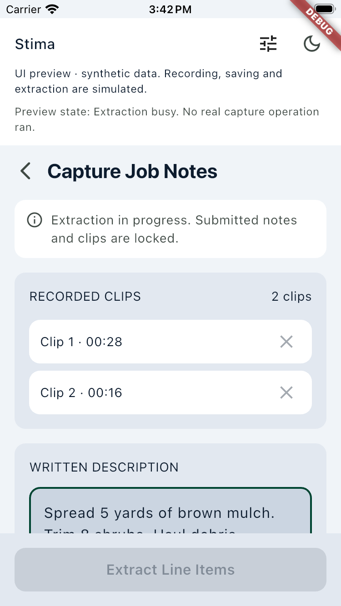

# iOS platform observations — 2026-10-31

The first Flutter slice compiled and visibly ran on an iOS simulator and a
physical iPhone using free Personal Team signing. The device debugger connection
did not complete. This is a factual evidence record, not a setup procedure or a
release-readiness approval.

## Tested source and environment

- Source: `7a708a4de1de2b755911804652d70905ffc819d9`, published on
  `delivery/flutter-first-slice`; baseline `f0f4c192c6f5a6a321483597ac9392be95711f22`.
- Mobile tree: `776dfb36d818ae7a1b7158af54f6699f436e3810`.
- All build attempts left tracked source unchanged. No bundle identifier, team,
  signing credential, dependency lockfile, or generated project edit was committed.
- Apple M5 / arm64; macOS 26.5.2 (25F84); Xcode 26.6 (17F113), selected command-line
  tools from that Xcode; iOS SDK 26.5; Swift 6.3.3; CocoaPods 1.16.2.
- Flutter 3.47.9, framework `c197ca5199e9ee5661e865596c9c07294dfab51c`, Dart 3.13.7.
- Simulator: task-owned iPhone SE (3rd generation), iOS 26.5 (23F77).
- Physical device: iPhone SE (3rd generation), iOS 27.0.1 (24A446), wired and
  paired, Developer Mode enabled. After unlocking, `devicectl` reported the
  developer disk image compatible and usable, and developer services available.
- An existing valid signing identity and matching local provisioning profiles
  were confirmed for the Personal Team. No company team or paid enrollment was used.

The official [Mac release manifest](https://storage.googleapis.com/flutter_infra_release/releases/releases_macos.json)
matched the pinned framework and Dart versions. The arm64 archive was
`stable/macos/flutter_macos_arm64_3.47.9-stable.zip`, 2,268,740,583 bytes; its verified
SHA-256 was `6545b85938745dc5070e9faf2adf70233c1811009d87fe6d27bfcda5a04b7698`.
The download archive was removed after installation. `flutter doctor` with the
pinned SDK on the process PATH passed Flutter, Xcode, connected-device and network
checks. Its remaining warning was unaccepted Android licenses; that pre-existing
Mac Android setup was outside this iOS check and was left unchanged.

## Commands and observed results

These record the options actually used, with machine-local paths, device IDs and
the personal team ID replaced by variables. Commands ran from `mobile/` with
`CI=true`; `$FLUTTER_SDK` refers to the verified pinned SDK.

```sh
"$FLUTTER_SDK/bin/flutter" --suppress-analytics --version --machine
"$FLUTTER_SDK/bin/flutter" --suppress-analytics pub get --enforce-lockfile
"$FLUTTER_SDK/bin/flutter" --suppress-analytics build ios --simulator --debug --no-codesign --no-pub
xcrun simctl install "$SIMULATOR_ID" build/ios/iphonesimulator/Runner.app
xcrun simctl launch "$SIMULATOR_ID" com.example.stimaMobile
```

Version and lockfile checks passed. The first simulator build passed in 168.2
seconds (147.6 seconds reported by Xcode); installation and launch succeeded.
Native simulator interaction exercised note editing, the light/dark theme switch,
and the synthetic Extraction busy/error states. Busy made notes read-only and
disabled deletion and Extract; error retained the supplied notes/clips and
restored editability. A software-keyboard inset was not qualified by these observations.

```sh
xcodebuild -workspace ios/Runner.xcworkspace -scheme Runner -configuration Debug \
  -sdk iphoneos -destination "id=$IOS_DEVICE_UDID" \
  -derivedDataPath "$PWD/build/ios-device-derived" \
  -clonedSourcePackagesDirPath "$PWD/build/ios/SourcePackages" \
  BUILD_DIR="$PWD/build/ios" CONFIGURATION_BUILD_DIR="$PWD/build/ios/iphoneos" \
  DEVELOPMENT_TEAM="$PERSONAL_TEAM_ID" CODE_SIGN_STYLE=Automatic \
  "CODE_SIGN_IDENTITY=Apple Development" COMPILER_INDEX_STORE_ENABLE=NO \
  FLUTTER_SUPPRESS_ANALYTICS=true -allowProvisioningUpdates build
```

The Personal Team device build passed in 21.9 seconds and signed the unchanged
`com.example.stimaMobile` application. An earlier invocation failed because it
combined Automatic signing with an explicit certificate identity; replacing that
command-line identity with `Apple Development` resolved the invocation conflict.
No project change was needed.

```sh
"$FLUTTER_SDK/bin/flutter" --suppress-analytics run --debug --no-pub --no-hot \
  --no-devtools --no-publish-port \
  --use-application-binary=build/ios/iphoneos/Runner.app -d "$IOS_DEVICE_UDID"
```

Flutter installed and started the prebuilt app on the physical phone; the process
resumed and logged the Metal/Impeller backend. Xcode's device screenshot captured
the visible Capture preview below. This establishes actual device display,
separately from debugger attachment.

## Residual proof

The default debugger connection waited, then reported a localhost WebSocket
connection closing before its HTTP header completed. One bounded launch retry
added `--device-vmservice-port=58631 --host-vmservice-port=58632` after confirming
the host port was free. The app again started, but the VM-service connection still
did not complete. Both attempts were interrupted after observation. No proxy
environment was set; the phone was unlocked and developer services were usable.
No SDK upgrade or privacy/security setting change was attempted.

The Mac platform workstream retains the debugger-transport follow-up. A working
VM-service connection remains unproved; hot reload was not attempted (`--no-hot`
was selected). Physical keyboard/touch journeys, microphone capture, background
interruption, durable storage, native auth and backend Extraction remain later
functional checks. All clips, messages and extraction states here are synthetic.
Windows' source checks were not rerun, and the combined delivery review was still
in progress when this record was prepared. No main merge or deployment occurred.

## Original app captures

Both files are original, unretouched screenshots with synthetic app content.

Physical iPhone SE, iOS 27.0.1: actual dark Capture preview after install/launch.



iPhone SE simulator, iOS 26.5: light theme with simulated Extraction busy,
locked inputs and disabled Extract.


